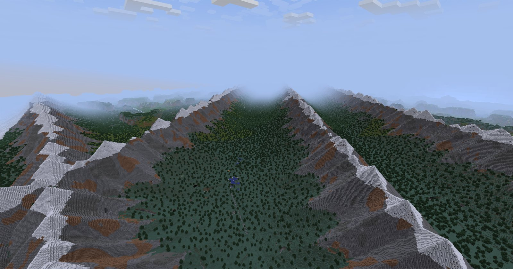
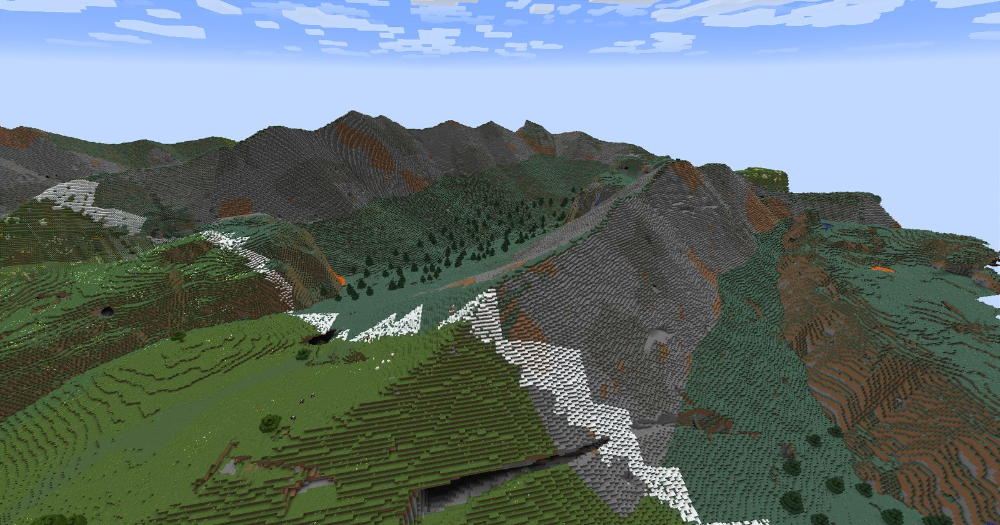
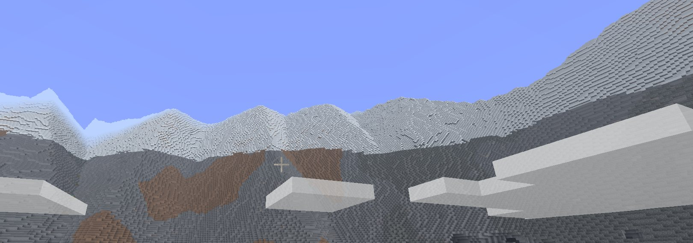
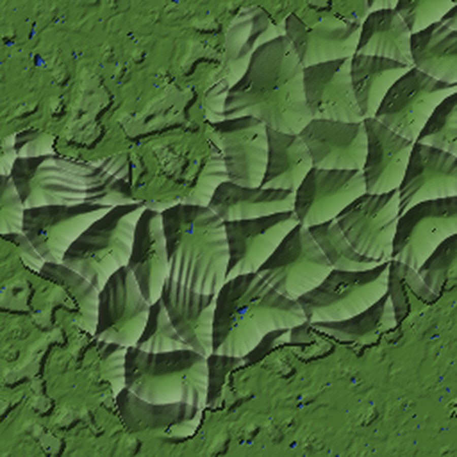

# Atlas Mountains

[](https://github.com/sammigare-collab/atlasmountains/actions/workflows/build.yml)


[](LICENSE)

A Fabric world-generation mod that swaps vanilla's mountains for sharp, angular ranges: networks of
horn-peak ridges with snow-capped summits, bare rock faces and small walled-in valleys, set into an
otherwise normal vanilla world.



## Features

- **New mountains, vanilla everything else.** Wherever vanilla would generate a mountain biome,
  the mod builds its own ranges instead. Rivers, caves, structures, villages and the other biomes
  are left to vanilla.
- **Ridge networks, not lone peaks.** Ranges stand back to back and meet at three-way junctions,
  with rows of pyramid summits along each crest. Heights vary from massif to massif, so some
  mountains tower over the ones leading up to them.
- **Enclosed valleys.** Where two ridges part, a small flat valley floor with a lake is walled in
  between them.
- **Snow line and treeline.** Snow starts at a height that rises with the climate, so it wraps the
  summits as a ragged contour, and below it snow lies in patches on ledges and gentle ground.
  Trees thin out and stop at the treeline.
- **Layered rock.** Steep faces show beds of stone, andesite, tuff and dripstone that bend
  gently along the ridges, like strata on a real mountain.
- **Blended edges.** Mountain provinces have ragged outlines and their foothills ease into the
  surrounding vanilla terrain rather than ending in a wall.
- **Continents.** Land comes in large, irregular continents and islands surrounded by ocean, with
  spawn always on land.
- **Opt-in.** Everything happens in the mod's own world type. Normal worlds, and worlds created
  before installing the mod, are untouched.

| | |
|---|---|
|  |  |
| Ridges dropping into vanilla meadow and forest | Snow on the summits along a ridge line |

<p align="center"><br>
<em>Heightmap of one mountain province (about 4 km across), from the mod's diagnostic tools</em></p>

## Installation

Requirements: **Minecraft 26.3**, [Fabric Loader](https://fabricmc.net/use/) 0.20.1 or newer,
[Fabric API](https://modrinth.com/mod/fabric-api) for 26.3, and Java 25.

1. Download the latest `atlasmountains-<version>.jar` from the
   [Releases](https://github.com/sammigare-collab/atlasmountains/releases) page.
2. Put it, together with Fabric API, in your `mods` folder.
3. Create a new world, open **More** → **World Type** and choose **Atlas Mountains**.

On a dedicated server, set `level-type=atlasmountains\:atlasmountains` in `server.properties`
before the world is first generated.

There is also an **Atlas Mountains (everywhere)** world type, which puts the ridges over the whole
world with no vanilla terrain at all. It is meant for looking at the mountain shapes on their own.

## Finding mountains

Mountain provinces are a few kilometres across and sit inland. If spawn is in lowland, these
commands (operator only) help:

| Command | What it does |
|---|---|
| `/atlasmountains scan` | Prints an 8 km map of mountains, land and sea around you to the server log |
| `/atlasmountains continents <km>` | Saves a PNG map of continents and mountain provinces into `<world>/atlasmountains/` |
| `/atlasmountains heightmap <size> <step>` | Saves a shaded heightmap PNG of the area around you |
| `/atlasmountains info` | Shows the terrain height, slope and mountain mask where you stand |

## Good to know

- Mountain terrain is eroded in 2048 x 2048 block regions. The first time you enter a new region
  there is a short pause while it is computed; it is cached in `<world>/atlasmountains/` after
  that.
- Changing the mod version can change the terrain. Generate new chunks with the version the world
  was made with, or expect seams at the border between old and new chunks.
- Tested on a dedicated server and a client on Minecraft 26.3. Compatibility with other
  world-generation or LOD mods has not been tested.

## Building from source

Needs JDK 25.

```sh
./gradlew build
```

The jar is written to `fabric/build/libs/`. The build also runs the unit tests in `core/`.

The worldgen JSON under `fabric/src/main/resources/data/` is generated, not hand-written. After
changing the generator:

```sh
python3 tools/extract_vanilla.py   # copies vanilla's worldgen data out of the game jar (after one Gradle build)
python3 tools/build_datapack.py    # regenerates the mod's datapack
```

How the terrain is put together, the code layout and the diagnostic tools are described in
[docs/how-it-works.md](docs/how-it-works.md). Version history is in [CHANGELOG.md](CHANGELOG.md).

## License

[MIT](LICENSE). Minecraft is a trademark of Mojang AB; this project is not affiliated with
Mojang or Microsoft.
