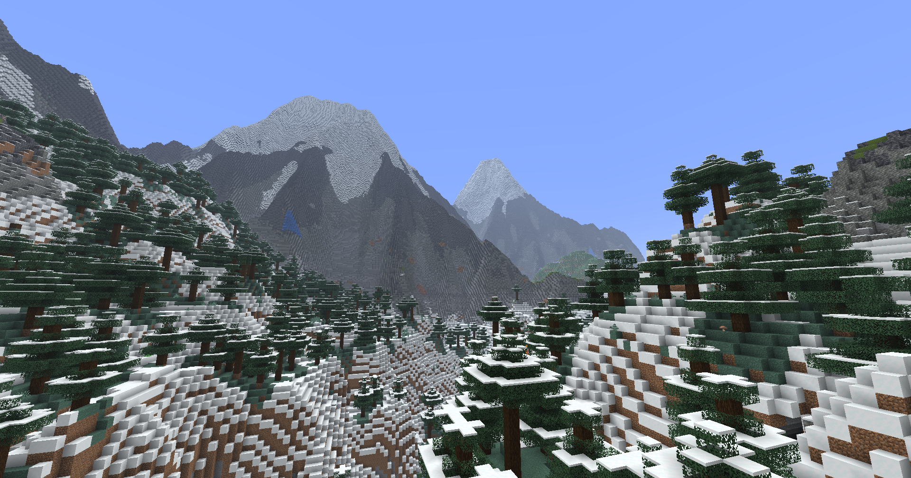
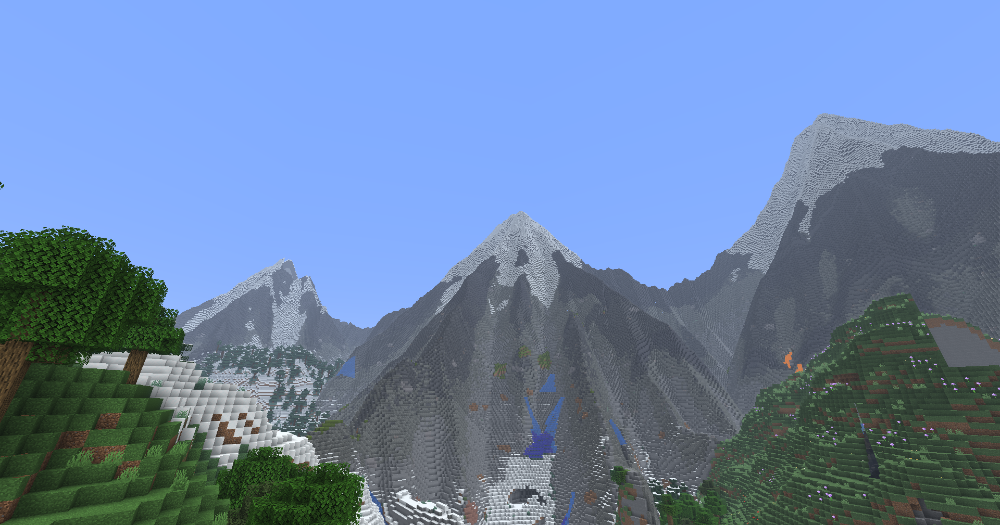

# Atlas Mountains

A Fabric mod for Minecraft 26.3 that reshapes vanilla's own mountains into tall, eroded,
snow-capped ranges. Everything else in the world stays vanilla.

## Features

- **Mountains shaped by erosion.** Each mountain is formed as a whole, from the valley floor to
  the summit: valleys, ridges, couloirs and sharp ribs of rock. Neighbouring peaks share a base
  and meet at saddles.
- **Tall.** Summits reach about y 400, up to 260 blocks above the land around them. Each range has
  one tallest peak, with the others stepping down towards its edges.
- **Ranges that end.** A range runs for a few thousand blocks and then stops. Between ranges the
  land is vanilla's high ground.
- **Snow and rock that follow the shape.** Snow lies in the hollows and on the gentler ground high
  up, and dark rock stands out on the ribs and cliffs. Lower down are grass and vanilla's own woods.
- **Real rivers.** Rivers run at water level through mountain country instead of drying up. Where
  a mountain is tall enough it covers the river, which comes out again on the far side.
- **A taller world.** The overworld's build height is raised from y 320 to y 512 to make room.

The mountains stand where vanilla already puts its peak and slope biomes. Biomes, caves,
structures and everything outside mountain country are vanilla's.

## Install

1. Install [Fabric Loader](https://fabricmc.net/use/) 0.20 or newer for Minecraft 26.3 (Java 25).
2. Put the Atlas Mountains jar and [Fabric API](https://modrinth.com/mod/fabric-api) in your
   `mods` folder. The jar is attached to each run of the
   [build workflow](https://github.com/sammigare-collab/atlasmountains/actions/workflows/build.yml),
   or you can build it yourself (see [docs/DEVELOPMENT.md](docs/DEVELOPMENT.md)).
3. **Create a new world.** Chunks that already exist keep their old shape.

There is nothing to pick when creating the world: the mod applies to the default world type.

## Commands

| Command | What it does |
|---|---|
| `/locate mountain` | Finds the nearest mountain. |
| `/locate mountain tallest` | Finds the tallest mountain within 6,000 blocks. |
| `/atlasmountains` | Shows the mod's version. |

`/locate mountain` needs cheats or operator, like `/locate biome`. Click the coordinates in the
answer to teleport.

## Compatibility

- **World types:** default only. Large Biomes and Amplified are not supported.
- **[Atlas Continents](https://github.com/sammigare-collab/atlas-continents):** the companion mod
  for continents and climate bands. The two are made to be used together, and the screenshots
  above were taken with both installed.
- **Other world-generation mods:** not tested. Anything that replaces the overworld's terrain
  settings is likely to clash.
- **Build height:** the overworld is y 512 tall with this mod, so tools and mods that assume
  y 320 may need their limits changed.

## More

- [Changelog](CHANGELOG.md)
- [How it works, building and debug commands](docs/DEVELOPMENT.md)
- Found a bug? [Open an issue](https://github.com/sammigare-collab/atlasmountains/issues/new/choose)
  with the seed and coordinates.

Built entirely by prompting Claude. MIT licensed.
